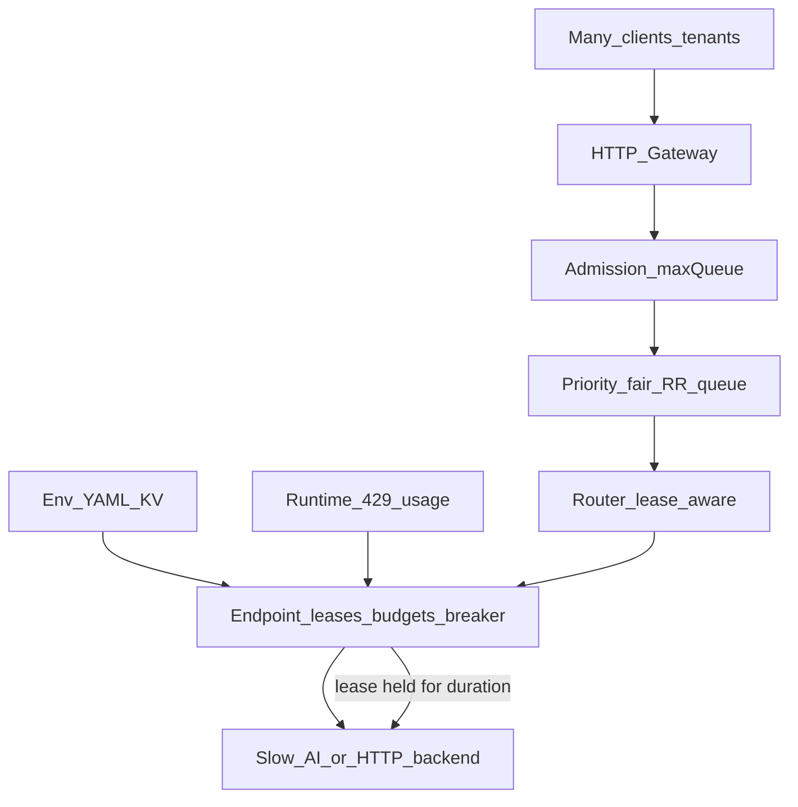

# Faction Gap Closure — Product Spine

## What we are building

A **dual-language service pool + resilience engine** for AI/HTTP backends:

`admit → fair priority queue → route → breakers/budgets → execute | stream | ops` + HTTP gateway.

North star under load: **many tenants / users sharing a few slow, capacity-limited backends** without stampeding them, without one tenant starving others, and without lying about gateway/adapter capabilities.

---

## How many users + slow services work (by design)

Slow backends are the normal case (LLM TTFT, DocIntel polls, cold starts). The pool absorbs that with **leases**, not threads-per-user.

| Pressure | Mechanism |
|---|---|
| More arrivals than capacity | Admission (`reject` / `timeout` / `drop_*`) + `maxQueueSize` |
| One tenant floods | Tenant governor quotas + **fair RR across tenants** per priority tier |
| VIP vs batch | Priority tiers (`CRITICAL`…`BATCH`) + `maxAllowedPriority` |
| Endpoint saturated | `maxConcurrency` leases + RPM/TPM/pages budgets; router prefers least-loaded / weighted |
| Job waits too long | `queueTimeoutMs` → fail fast, refund tenant charge |
| Backend dying / 429 | Breaker + Retry-After + global retry budget; `UNAVAILABLE` → avoid that endpoint on retry |
| Long stream / LRO | Stream/ops **bypass fair queue** but still take a **lease + budget** for the whole hold; abort must release |
| Shedding under overload | Gateway returns **429** with stable `error.code` so clients back off |

**Implication:** N users share a bounded set of endpoint leases. When all leases are held by slow calls, new work **queues or sheds** — that is the product, not a bug.

---

## Large contexts (e.g. 1M tokens)

Faction pools **capacity**, not context storage. Big prompts are in-memory jobs; gateway TS body cap ~10MB; estimate ≈ `chars/4 + maxTokens`; reconcile to provider `usage` when present. Exceeding pool TPM → shed; exceeding provider window → FATAL 4xx. No blob spill / auto-chunk in this pass.

---

## Capacity sourcing (promoted into this plan)

Today limits are mostly **hardcoded in demos**. This pass productizes **E2 + E3**. **E1 (learn caps from the service) is deferred.**

Precedence now (highest wins for a field unless noted):

1. **Runtime signals** (temporary effective caps — decay/revert)
2. **`.env` / YAML / KV`** (declared baseline at startup / reload)
3. **In-code `EndpointConfig` / `TenantConfig`** (defaults / programmatic override)

Later (E1): optional QuotaProbe may sit between signals and config once implemented.

### E2 — `.env` / KV / YAML (declared baseline)

**Goal:** operators set RPM/TPM/concurrency/queue/tenant limits without recompiling demos.

- Shared schema (document once): pools, endpoints (`id`, `url`, `maxConcurrency`, `budget.rpm|tpm|pages|rps`, `weight`, `timeoutMs`), tenants (`maxRps`, `maxTpm`, …), gateway (`apiKey`, `maxBodyBytes`), optional `FACTION_` env overlays.
- Loaders in both packages:
  - TS: read `FACTION_CONFIG` path (YAML or JSON) + `process.env` overlays (e.g. `FACTION_ENDPOINT_<ID>_TPM`).
  - Rust: same paths via `std::env` + a small YAML/JSON parse (keep deps minimal; JSON-first acceptable if YAML adds weight).
- Wire `cli.ts` / `main.rs` demos to load config file when present, else keep embedded demo defaults.
- Secrets: credentials stay vault/env (`FACTION_ENDPOINT_<ID>_API_KEY`) — never commit secrets in YAML samples; ship `faction.config.example.yaml` + `.env.example`.

### E3 — Runtime signals (adapt effective caps)

**Goal:** 429 / Retry-After / usage reconcile can **temporarily tighten** effective endpoint budgets so the pool stops stampeding a throttled backend.

- On `OVERLOADED` + `Retry-After`: optionally lower **effective** RPM (and/or pause acquires) for that endpoint until retry-after elapses; then restore toward declared baseline.
- On reconcile: if `actual.tpm` repeatedly ≫ estimate, optionally raise the job’s future estimate bias **or** mark a short-lived “TPM pressure” flag that prefers other endpoints (do not silently inflate declared TPM above baseline without probe/config).
- Bounds: never raise effective caps **above** declared baseline from signals alone; only tighten or restore. Emit metrics: `effectiveRpm`, `effectiveTpm`, `signalTightened`.
- Must work with existing breaker (signals ≠ replace half-open probe).

### E1 — Learn caps from the service (DEFERRED — later)

Not implemented this pass. When revived:

- Optional `QuotaProbe` / `probeQuota(endpoint) -> { rpm?, tpm?, maxConcurrency?, contextWindowTokens? }`.
- Static model registry KV and/or OpenAI/Azure quota APIs; interval refresh; failures keep baseline.
- Does not block pool startup; config/code baseline remains sufficient.

---

## Sticky / affinity

Default remains lease-aware load spread. Sticky is **design-only backlog** this pass (`sticky_with_failover` keyed by `stickyKey`/`tenantId`, never bypasses admission/budgets).

---

## Spine work

### Spine A — Correctness
- Ops single `releaseSlot`; snapshot poll; `awaitOperation` loops; `admitAndEnqueue`; Retry-After ms; `UNAVAILABLE` avoid-list.

### Spine B — Slow-backend multi-user
- Cool-off/health wake dispatch; `remove_endpoint` removes; drain rejects queue; stream/ops abort releases lease.

### Spine C — Gateway minimum
- Rust opaque ops + SSE; Bearer CI; health uptime; 429 + `error.code`; TS single priority cap; honest docs.

### Spine D — Claimed adapters
- LLM stream for documented providers; Mock goldens; Rust PII flag wired.

### Spine E — Capacity sourcing (this pass)
- **E2** config files/env and **E3** runtime signal tightening — as specified above.
- **E1** deferred (see backlog).

### Still not this pass
- **E1 learn-caps / QuotaProbe.**
- Blob spill / auto-chunking / real tokenizer.
- Full DocIntel/Embedding Rust ports (unless promoted later).
- Sticky implementation, Redis shared budgets, OAuth/MI, OTel, gRPC.
- Parity polish sprawl (serde renames, vault regex breadth, etc.).

---

## Todo map

| Todo | Scope |
|---|---|
| `spine-correctness` | A |
| `spine-slow-backend` | B |
| `spine-gateway` | C |
| `spine-adapters-min` | D |
| `capacity-config-files` | E2 |
| `capacity-runtime-signals` | E3 |
| `backlog-learn-caps` | E1 later — no code this pass |
| `backlog-sticky` | Design note only |

Suggested implement order: **A → B → C → D → E2 → E3**.

---

## Success criteria

1. Multi-tenant slow-mock load: queue ≤ max, leases ≤ maxConcurrency, fair RR visible; abort frees leases.
2. TS/Rust gateway: execute + SSE stream + opaque ops poll without `x-endpoint-id`.
3. Pool starts from **example YAML/.env** with real rpm/tpm/concurrency (demos).
4. Under synthetic 429s, effective caps **tighten** then restore; metrics show signal pressure.
5. README states capacity precedence: signals → config/env → code (E1 probe later).
